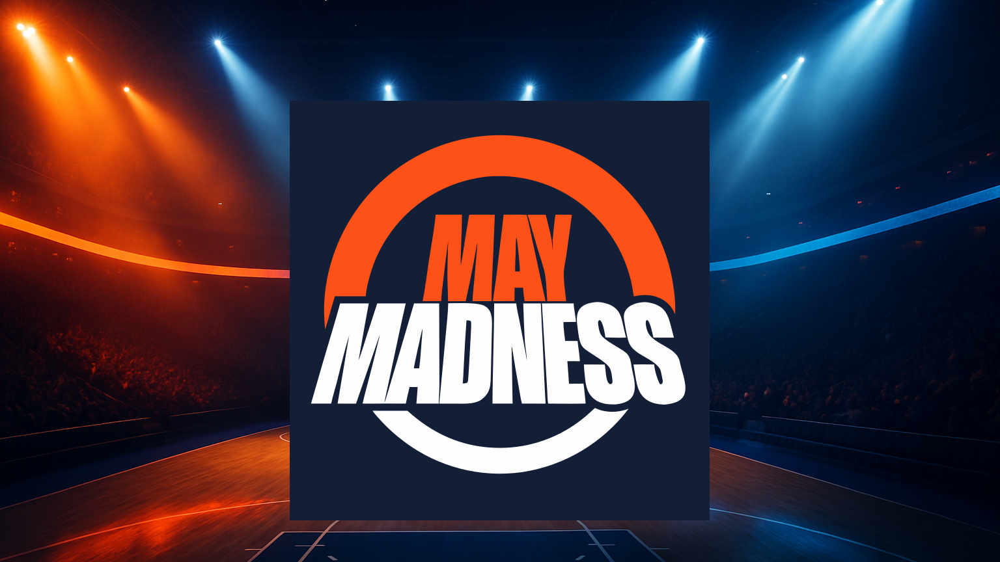

# CreativeOps AI

### Enterprise Agentic Creative Operations | Production Architecture Reference Demo



## Project Overview

CreativeOps AI is a simplified demonstration of a production agentic AI system I designed and built for ESPN during my tenure at The Walt Disney Company.

The original system supported AI-assisted creative asset production and orchestration across ESPN's existing media infrastructure, integrating generative AI with enterprise asset management, editorial workflows, and publishing systems.

This public repository illustrates one specific workflow from that larger architecture using a fictional sports broadcaster, Summit Sports Network.

## Original Production Architecture

The ESPN production implementation used the following technologies:

|Technology|                                     | Production Responsibility |


| **AWS EventBridge** |                          | Event-driven workflow orchestration |

| **Python services** |                          | Custom orchestration, business logic, and integration services |

| **Amazon Bedrock**  |                          | Generative AI model access and inference |

| **Midjourney**      |.                         | AI-assisted creative asset generation |

| **Amazon S3**       |                          | Storage and transfer of generated creative assets |

| **Enterprise Digital Asset Management (DAM)**  | Retrieval and management of authoritative media and brand assets |

| **Disney Content Management System** |         | Editorial review and approval |

| **Internal media infrastructure APIs** |.      | Integration with broadcast metadata and publishing systems |

The architecture connected generative AI capabilities to existing enterprise systems rather than replacing those systems with an autonomous agent.

## Capabilities of the Original Production System

The production implementation supported:

- **Event-driven orchestration:** Coordinating creative production workflows through AWS EventBridge and custom Python services.

- **Generative asset production:** Using Amazon Bedrock and Midjourney to generate creative materials.

- **Enterprise asset management:** Retrieving approved brand assets and transferring generated materials between Amazon S3 and the existing DAM.

- **Metadata-driven workflows:** Integrating with ESPN's internal media infrastructure and broadcast metadata services.

- **Editorial approval:** Routing generated assets through Disney's existing content management system for human review.

- **Publishing integration:** Connecting approved creative materials to downstream publishing workflows.

- **Enterprise API integration:** Coordinating services across proprietary internal systems and AWS infrastructure.

## What This Demo Illustrates

This repository implements **one deliberately narrow workflow** from the larger production architecture:

1. Retrieve an approved campaign logo from Google Drive.

2. Generate a creative background using the OpenAI Images API.

3. Verify the approved logo against its campaign manifest and SHA-256 fingerprint.

4. Composite the approved logo over the generated background using deterministic Python services.

5. Present the finished graphic for human approval or rejection.

6. Persist the review decision against the exact artifact version.

The fictional Summit Sports Network and May Madness campaign provide a self-contained example without exposing ESPN's proprietary systems, assets, or internal code.

**This is not a reproduction of ESPN's production infrastructure.** It is a smaller implementation of the same architectural principles, using publicly accessible technologies.

The demo intentionally uses a simple Python workflow rather than recreating the original system's event-driven infrastructure. It focuses on the separation of generative AI, deterministic governance, enterprise asset integration, and human authorization.
## Demonstrated Workflow

This repository implements a local reference workflow for a fictional sports broadcaster, Summit Sports Network, and its May Madness campaign.

```text
Approved Campaign Assets
      |
      v
Google Drive Asset Retrieval
      |
      v
Campaign Manifest + SVG Logo
      |
      v
SHA-256 Integrity Verification
      |
      v
AI-Generated Background
      |
      v
Deterministic Image Composition
      |
      v
Campaign Promotional Graphic
      |
      v
Streamlit Human Review
      |
      +---- Approve
      |
      +---- Reject
      |
      v
Persisted Review Record
```

The workflow produces one 16:9 promotional graphic and supports one human approval or rejection decision at a time.

## Capabilities Demonstrated

### 1. AI Image Generation

An OpenAI image-generation integration produces a campaign background from creative instructions.

The generated background is treated as creative material, not as an authoritative source for brand identity.

### 2. Google Drive Asset Integration

Google Drive OAuth provides access to an approved campaign asset library.

The reference implementation retrieves campaign materials and stores local working copies for validation and composition.

Approved campaign logos are maintained separately from generated imagery.

### 3. Deterministic Brand Governance

Before composition, Python validation checks:

- Campaign logo approval status
- Expected asset filename
- SHA-256 integrity against the campaign manifest

A failed validation stops composition.

The model cannot override these checks.

### 4. Deterministic Image Composition

Python and image-processing libraries combine the generated background with the approved SVG logo.

The logo is rendered from the approved source file rather than regenerated by an image model.

The composition process crops the background to a 16:9 output.

### 5. Human Approval

A Streamlit interface displays the completed graphic and allows a reviewer to approve or reject it.

Each review record includes:

- Campaign and artifact filename
- SHA-256 fingerprint of the reviewed image
- Approval or rejection decision
- Reviewer name
- Review comments
- UTC timestamp

The fingerprint ties the decision to the exact artifact reviewed.

### 6. Explicit Workflow Coordination

A Python workflow entry point coordinates asset validation and image composition.

The current implementation deliberately favors deterministic orchestration over unnecessary multi-agent complexity.

## Architecture

| Component | Technology | Responsibility |
|---|---|---|
| Workflow coordination | Python | Execute the local composition workflow |
| Image generation | OpenAI Images API | Generate creative background imagery |
| Brand asset storage | Google Drive | Store approved campaign assets |
| Authentication | Google OAuth | Authorize Drive access |
| Asset governance | Python, JSON, SHA-256 | Validate approved logo identity and integrity |
| Image composition | Pillow, CairoSVG | Produce the branded campaign graphic |
| Human review | Streamlit | Present artifact and collect approval decisions |
| Review persistence | Local JSON | Record decisions against artifact fingerprints |

## Run the Local Demo

### Prerequisites

- Python
- An existing campaign manifest and approved SVG logo
- A generated campaign background image
- Native Cairo library for SVG rendering

Install Python dependencies:

```bash
pip install -r requirements.txt
```

On macOS, install Cairo if necessary:

```bash
brew install cairo
```

### Run Composition

From the repository root:

```bash
DYLD_FALLBACK_LIBRARY_PATH="$(brew --prefix cairo)/lib" python3 app/workflow.py
```

This validates the approved logo and creates:

```text
data/generated/may_madness_promo.png
```

### Run Human Review

```bash
streamlit run app/review.py
```

Open the local Streamlit interface, inspect the graphic, enter a reviewer name, and select **Approve** or **Reject**.

The decision is saved locally to:

```text
data/generated/may_madness_review.json
```

Review records are excluded from Git.

## Project Structure

```text
app/
  composition.py       # Asset validation and image composition
  review.py            # Streamlit approval interface
  workflow.py          # Local workflow entry point

integrations/
  google_drive.py      # Google Drive OAuth and asset retrieval
  openai_images.py     # OpenAI image-generation integration

data/
  assets/              # Approved local campaign assets
  generated/           # Generated and composed artifacts
  may_madness_campaign_manifest.json

scripts/               # Supporting initialization utilities
tests/                 # Existing project tests
```

## Current Scope and Limitations

This is a **local reference implementation**, not a deployed enterprise production system.

The demonstrated workflow includes image generation, Drive asset retrieval, validation, composition, and human review, but these components are not yet connected into a single end-to-end execution.

Specifically:

- Image generation and Google Drive retrieval are run separately from the current workflow coordinator.
- The coordinator validates and composes existing local assets.
- Review decisions are stored in a local JSON file.
- The review interface does not provide authenticated user identity.
- Approval does not trigger publication.
- No distributed queue, webhook processing, or automated retry infrastructure is implemented.
- No multi-agent system is implemented.
- The reference workflow supports one campaign and one output format.

The repository demonstrates engineering patterns that could be extended into an enterprise workflow without claiming those extensions already exist.

## Enterprise Integration Opportunities

A production implementation could add:

**Event-driven orchestration:** Use an event bus or workflow engine to coordinate asset ingestion, generation, validation, review, and downstream delivery.

**Enterprise DAM integration:** Replace local working copies with versioned asset retrieval, metadata validation, and authoritative asset identifiers.

**API and webhook interfaces:** Accept campaign briefs from creative operations platforms and emit review-status events to downstream systems.

**Durable state and retries:** Persist workflow state in a database, apply idempotency keys, and retry recoverable integration failures.

**Identity and authorization:** Integrate enterprise SSO, reviewer roles, and approval permissions.

**Observability:** Add structured execution logs, trace identifiers, operational metrics, and alerts.

**Publishing controls:** Permit delivery only when the approval record matches the exact artifact version being published.

These are proposed extensions, not capabilities of the current demo.

## Design Philosophy

CreativeOps AI separates probabilistic generation from deterministic governance.

The system does not ask an LLM whether an approved logo is valid. It checks the manifest and verifies the file.

It does not ask an image model to reproduce authoritative brand artwork. It composites the approved artwork directly.

And it does not treat successful generation as authorization to publish. That decision remains with a human reviewer.

**The model creates possibilities. The workflow enforces constraints. The reviewer makes the decision.**
